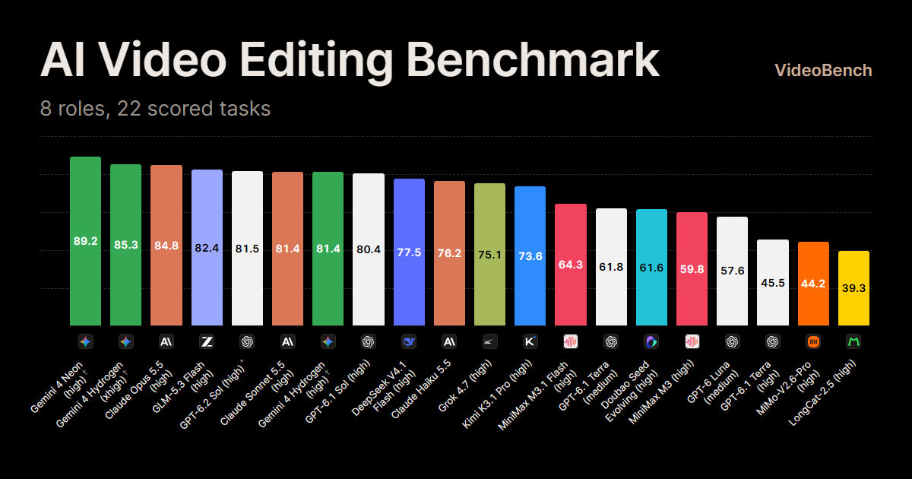

# VideoBench

[](https://huaiyuan-jiang.github.io/videobench/en/)

[中文](README.md)

VideoBench tests AI agents as assistants for a video editor. Each model gets real editing chores: log footage, find shots, cut a voiceover, review a cut, fix subtitles. We check the files it hands back, and we check whether its report tells the truth.

This repository has the framework, the scoring rules, the site builder, the public results and two sample tasks. The task bank is private and is not here.

## What is measured

- 8 roles, 3 tasks each. One task is withdrawn and one is for reference only, so 22 tasks count.
- 7 speed probes, 3 runs each. They show on the "more" page and do not enter the total.
- Every task is scored from the files the model wrote, not from its chat reply.
- A false claim in the report zeroes the task. So do timeouts, errors, missing work and cheating.

Roles: SORT Footage Logging · FIND Shot Finding · VO Voiceover Editing · CUT B-roll Editing · TASTE Taste · QC Review · FIX Revisions · SUB Subtitles. The leaderboard has a page for each.

How the numbers are computed: [docs/METHOD.md](docs/METHOD.md).

## Run the sample

You need Python 3.11+ and Pillow. Nothing else: no account, no key, no task bank.

```sh
pip install -r requirements.txt
python -B generators/SAMPLE.py           # optional: rebuild the two sample tasks
python -B -m unittest discover -s tests
python -B tools/sample_chain.py          # set up, answer, collect, grade, summarize
python -B tools/sample_site.py           # leaderboard page from that run
```

`sample_chain.py` plays three fixed answer sets (reference, empty, deliberately wrong) instead of calling a model. The page lands in `out/sample/out/site/index.html`. Times and token counts on that page are placeholders.

Working directories go to your temp folder. Set `VIDEOBENCH_WORK` to put them somewhere else.

## Rebuild the leaderboard

```sh
python -B site/build.py --no-card
```

This reads `data/` and writes the site to `out/site/`. With `--no-card` it skips the preview image, which needs Playwright. Point `VIDEOBENCH_FONTS` at a folder with Inter and Noto Sans SC to embed the same fonts as the live site.

## Add your own tasks

A task is a brief, an input folder, an answer key and a grader. [docs/CONTRACT.md](docs/CONTRACT.md) describes the files, and `generators/SAMPLE.py` with `grading/SAMPLE/` is a working example.

To test a model:

1. `python -B make_workdir.py --batch b1 --examinee mymodel`. The first run only writes a template to `runs/mymodel/card.json` and stops.
2. Fill in the card: `label`, `short_label`, `vendor`, the `target` you will call, and what the model can take as input.
3. Run the same command again. It builds the working directories and writes `runs/mymodel/dispatch.json`.
4. Give the model each `prompt` from `dispatch.json`, one fresh session per entry.
5. Run `collect.py --examinee mymodel`, `grade.py --examinee mymodel` and `summarize.py`.

## Layout

```
bench/        scoring, grading helpers, summary
site/         leaderboard builder, labels, role texts, vendor logos
data/         public results: summary, reviews, thinking-tic counts
tasks/SAMPLE  grading/SAMPLE  generators/SAMPLE.py   sample tasks
tools/        sample chain, leak check, git hook
tests/
docs/         method, task contract, data format
```

## License

- Code: MIT, see [LICENSE](LICENSE).
- Results in `data/`, reviews and docs: CC BY 4.0, see [LICENSE-CC-BY-4.0.md](LICENSE-CC-BY-4.0.md).
- Vendor logos in `site/logos/` are trademarks of their owners and are not covered by either license.
- The task bank is not in this repository.

## Star history

[](https://star-history.com/#Huaiyuan-Jiang/videobench-kit&Date)
