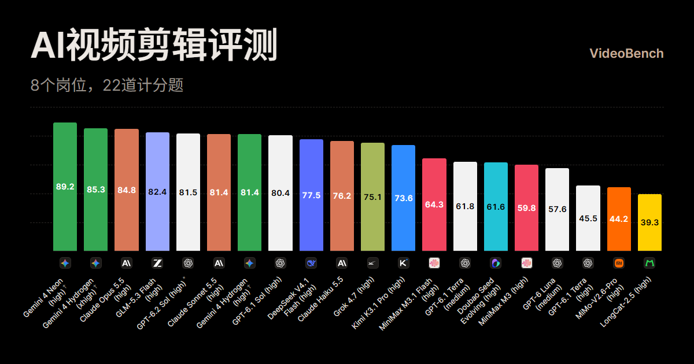

# VideoBench

[](https://huaiyuan-jiang.github.io/videobench/)

[English](README.en.md)

VideoBench 测 AI 能不能给剪辑师当助手。每个模型拿到的是真实的剪辑杂活：给素材登记、找镜头、精剪口播、审片、改字幕。我们看它交回的文件，也看它的报告有没有说实话。

这个仓库放的是测评底座、计分规则、建站程序、公开成绩和两道样题。题库不公开，不在这里。

## 测什么

- 8 个岗位，每个 3 道题。撤下一道、一道只作参考，计分的是 22 道。
- 7 种速度探针，每种跑 3 次。放在「更多指标」页，不进总分。
- 每道题按模型写出的文件判分，不看聊天回复。
- 报告里有一条声明被证据推翻，这题记 0 分。超时、出错、没交卷、作弊也是 0 分。

岗位：SORT 素材归类、FIND 镜头查找与识别、VO 口播精剪、CUT 口播配画面、TASTE 审美判断、QC 审片、FIX 改片、SUB 字幕制作。每个岗位在榜单上有自己的一页。

分数怎么算见 [docs/METHOD.md](docs/METHOD.md)。

## 跑样题

要 Python 3.11 以上和 Pillow。不要账号，不要密钥，不要题库。

```sh
pip install -r requirements.txt
python -B generators/SAMPLE.py           # 可选：重新生成两道样题
python -B -m unittest discover -s tests
python -B tools/sample_chain.py          # 建目录、放作答、收卷、判分、汇总
python -B tools/sample_site.py           # 用这次结果出一个榜单网页
```

`sample_chain.py` 不调模型，放三份现成作答：参考答案、空作答、故意做错。网页在 `out/sample/out/site/index.html`。页上的用时和 token 是占位数。

工作目录默认放在系统临时目录，想换地方就设 `VIDEOBENCH_WORK`。

## 重建榜单

```sh
python -B site/build.py --no-card
```

读 `data/`，网页写到 `out/site/`。`--no-card` 跳过预览图，预览图要装 Playwright。想和线上用一样的字体，把 `VIDEOBENCH_FONTS` 指到放着 Inter 和 Noto Sans SC 的文件夹。

## 加自己的题

一道题是一份简报、一个输入目录、一份答案和一个判分器。文件格式见 [docs/CONTRACT.md](docs/CONTRACT.md)，`generators/SAMPLE.py` 和 `grading/SAMPLE/` 是能跑的例子。

考一个模型：

1. 跑 `python -B make_workdir.py --batch b1 --examinee mymodel`。第一次只写出名片模板 `runs/mymodel/card.json` 就停。
2. 填好名片：`label`、`short_label`、`vendor`、要调用的 `target`，以及模型能收什么输入。
3. 同一条命令再跑一次。这次建好工作目录，写出 `runs/mymodel/dispatch.json`。
4. 把 `dispatch.json` 里每条 `prompt` 交给模型，一条开一个新会话。
5. 跑 `collect.py --examinee mymodel`、`grade.py --examinee mymodel` 和 `summarize.py`。

## 许可

- 代码用 MIT，见 [LICENSE](LICENSE)。
- `data/` 里的成绩、评语和文档用 CC BY 4.0，见 [LICENSE-CC-BY-4.0.md](LICENSE-CC-BY-4.0.md)。
- `site/logos/` 里的厂商图标是各家的商标，不在上面两种许可里。
- 题库不在这个仓库里。

## Star 趋势

[](https://star-history.com/#Huaiyuan-Jiang/videobench-kit&Date)
